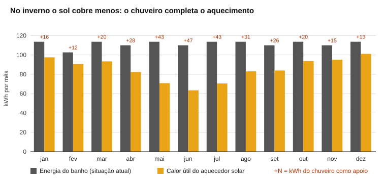

# Análise energética: água quente para o banho

**Disciplina:** Soluções em Energias Renováveis e Sustentáveis · **Projeto:** Citizen Assist AI · **Turma:** 1CCA

**Integrantes:** Guilherme Figueira Velloso (RM 568827) · José Manfrinato (RM 571151)

Para a família de referência, encurtar o banho economiza R$ 317 por ano sem custo, e um aquecedor solar economiza R$ 810 por ano e se paga em cerca de 4 anos. As duas medidas juntas cortam 91% do consumo elétrico do banho. Os números saem de `src/calculos.py` e estão reproduzidos em [`resultados.md`](resultados.md); este documento explica os dados, o método e as decisões.

## 1. Contexto

**Público.** Famílias da Grande São Paulo atendidas pela Enel SP que aquecem a água do banho com chuveiro elétrico.

**Necessidade energética.** Água quente para o banho de todos os moradores durante um ano. O chuveiro elétrico tem a maior potência entre os aparelhos comuns de uma casa (5.500 W no modelo de referência), e o seu gasto costuma passar despercebido porque não há medidor por aparelho.

**Como as orientações ajudam.** O módulo de energia do Citizen Assist AI mostra quanto o chuveiro de cada casa gasta em kWh e em reais, compara duas alternativas para a mesma necessidade e recomenda a mais adequada à situação da família (por exemplo, quem mora de aluguel não pode instalar aquecedor solar).

## 2. Dados utilizados

Todos os valores, com unidade, origem e tipo, estão em [`dados/parametros.json`](../dados/parametros.json). Os arquivos brutos baixados das fontes estão em `dados/brutos/`. Fontes consultadas em 17/11/2026.

| Dado | Valor | Unidade | Período | Tipo | Origem |
| --- | --- | --- | --- | --- | --- |
| Tarifa residencial B1 (TUSD + TE) | 0,78938 | R$/kWh | a partir de 04/07/2026 | Real | Enel SP, Resolução Homologatória ANEEL nº 3.596/2026 |
| Fator médio de emissão do SIN | 0,0461 | kg CO₂/kWh | média de 2025 | Real | MCTI/SIRENE, planilha de inventários |
| Irradiação solar global horizontal, por mês | 3,26 a 5,49 (média 4,53) | kWh/m²/dia | climatologia 2001–2025 | Real | NASA POWER, São Paulo (−23,55; −46,63) |
| Temperatura média do ar, por mês | 15,9 a 22,4 | °C | climatologia 2001–2025 | Real | NASA POWER |
| Custo do aquecedor solar instalado (200 L, 2 m²) | 3.359,57 | R$ | referência 09/2026 | Real | SINAPI, composição 103517 |
| Produção de um coletor classe A de 1,96 m² | 165,2 | kWh/mês | ensaio Inmetro | Real | Ficha técnica Komeco (só conferência) |
| Pessoas, potência, minutos de banho | 4; 5.500 W; 10 min | — | — | Estimado | Família de referência do grupo |
| Banho mais curto (alternativa A) | 7 | min | — | Estimado | Meta do grupo |
| Vazão do chuveiro | 3,0 | L/min | — | Estimado | Usada só na conferência física e no cálculo de água |
| Parâmetros do coletor: FR(τα)n, FR·UL, (τα)/(τα)n | 0,70; 5,5 W/m²·K; 0,94 | — | — | Estimado | Valores típicos de coletor plano com vidro (Duffie e Beckman) |
| Temperatura da água quente no reservatório | 45 | °C | — | Estimado | Premissa do grupo |
| Custo alto do aquecedor (sensibilidade) | 6.000 | R$ | — | Estimado | Casa que precisa refazer a tubulação de água quente |
| Vida útil considerada | 15 | anos | — | Estimado | Horizonte da economia acumulada |

**Premissas gerais.** Período de referência comum de 1 ano (365 dias) para todas as alternativas. Um banho por pessoa por dia, sempre na potência máxima. Tarifa sem ICMS, PIS/COFINS e bandeira tarifária. Água da rede na temperatura média do ar do mês.

## 3. Método

### 3.1 Consumo do chuveiro

Energia é potência multiplicada pelo tempo de uso:

```latex
E = P \cdot t = 5{,}5\ \text{kW} \times \tfrac{10}{60}\ \text{h} = 0{,}917\ \text{kWh por banho}
```

Para 4 pessoas durante 365 dias: 0,917 × 4 × 365 = **1.338 kWh por ano**, ou R$ 1.056,45 com a tarifa B1. Por mês, cerca de 111,5 kWh.

**Conferência física.** O calor que aquece a água vale Q = m · c · ΔT. Com vazão de 3 L/min (0,05 kg/s), o chuveiro de 5.500 W eleva a água em ΔT = P / (ṁ · c) = 5.500 / (0,05 × 4.186) ≈ 26,3 °C. Partindo de 16 a 22 °C, a água sai entre 42 e 49 °C, temperatura de banho quente. Como o chuveiro é uma resistência, praticamente toda a energia elétrica vira calor na água, por isso a carga térmica do banho é igual ao consumo elétrico.

### 3.2 Alternativa A: banho mais curto

Reduzir o banho de 10 para 7 minutos corta 30% da energia, porque o consumo é proporcional ao tempo. Também economiza água: 3 min × 3 L/min × 4 pessoas × 365 dias = 13.140 litros por ano.

### 3.3 Alternativa B: aquecedor solar com o chuveiro como apoio

O aquecedor solar é um coletor no telhado ligado a um reservatório térmico. O sol aquece a água; nos dias de pouco sol, o chuveiro elétrico completa o aquecimento.

A parte da energia do banho coberta pelo sol em cada mês (a fração solar f) foi calculada pelo **método f-chart**, o método mensal padrão de projeto de aquecimento solar (Duffie e Beckman, cap. 20). Ele usa dois números adimensionais:

```latex
X = \frac{A \cdot F_R U_L \cdot (100 - T_a) \cdot \Delta t}{L} \qquad Y = \frac{A \cdot F_R(\tau\alpha)_n \cdot \tfrac{(\tau\alpha)}{(\tau\alpha)_n} \cdot \bar{H} \cdot N}{L}
```

```latex
f = 1{,}029\,Y - 0{,}065\,X - 0{,}245\,Y^2 + 0{,}0018\,X^2 + 0{,}0215\,Y^3
```

X compara as perdas de calor do coletor com a carga do mês (L) e Y compara a energia solar absorvida com essa mesma carga. A correlação já incorpora a variação do sol de um dia para o outro: mesmo num mês ensolarado, sequências de dias nublados exigem apoio elétrico. X recebe as correções do método para volume de reservatório (200 L / 2 m² = 100 L/m²) e para aquecimento de água de consumo.

Junho, o pior mês, como exemplo: L = 110 kWh, H̄ = 3,26 kWh/m²/dia e Tₐ = 16,3 °C dão X = 6,02, Y = 1,17 e **f = 58%**. Em dezembro, f chega a 89%. Na média do ano, o sol cobre **77%** da energia do banho; o chuveiro fornece os outros 23% (313 kWh).

O grupo limitou f a 95% em qualquer mês: um sistema folgado ainda precisa de algum apoio, e a correlação não deve ser usada muito fora da faixa em que foi ajustada.

**Conferência.** O sistema calculado entrega em média 42,7 kWh por m² por mês. Um coletor comercial classe A declara 84,3 kWh por m² por mês nas condições de ensaio do Inmetro. O valor do grupo é menor porque usa o clima de São Paulo e só conta o calor efetivamente usado no banho, o que indica uma estimativa conservadora.

### 3.4 Custos, retorno e emissões

- Custo anual = kWh × tarifa.
- Retorno simples = investimento ÷ economia anual (sem juros, reajuste de tarifa nem manutenção).
- Emissões = kWh × 0,0461 kg CO₂/kWh.

## 4. Resultados

Família de referência, 1 ano, tarifa sem tributos.

| Situação | Consumo elétrico (kWh/ano) | Custo (R$/ano) | Economia (R$/ano) | Investimento (R$) | Retorno simples | Fração solar | CO₂ evitado (kg/ano) |
| --- | --- | --- | --- | --- | --- | --- | --- |
| Situação atual (chuveiro elétrico) | 1.338 | 1.056,45 | — | — | — | — | — |
| A - Banho mais curto | 937 | 739,52 | 316,94 | 0,00 | imediato | — | 18,5 |
| B - Aquecedor solar + chuveiro como apoio | 313 | 246,73 | 809,72 | 3.359,57 | 4,1 anos | 77% | 47,3 |
| A+B - As duas medidas | 118 | 92,92 | 963,53 | 3.359,57 | 3,5 anos | 87% | 56,3 |



No inverno o sol cobre menos (58% em junho) justamente quando a água da rede está mais fria. É nesses meses que o chuveiro mais trabalha como apoio.

**Sensibilidade da alternativa B.** O retorno fica entre 3,7 e 4,7 anos com o custo do SINAPI, conforme a qualidade do coletor. Se a casa precisar refazer a tubulação e o custo subir para R$ 6.000, o retorno vai para 6,6 a 8,4 anos. A tabela completa está em [`resultados.md`](resultados.md).

## 5. Comparação das alternativas

| Critério | A - Banho mais curto | B - Aquecedor solar |
| --- | --- | --- |
| Fonte de energia | Mesma rede elétrica, usada por menos tempo | Solar térmica (renovável), com a rede como apoio |
| Investimento | Nenhum | R$ 3.359,57 (SINAPI) a cerca de R$ 6.000 |
| Economia anual | R$ 317 (402 kWh) | R$ 810 (1.026 kWh) |
| Retorno | Imediato | 3,7 a 8,4 anos |
| Viabilidade | Qualquer casa, inclusive alugada ou apartamento. Depende de mudar o hábito | Exige casa própria com telhado ensolarado (de preferência voltado ao norte), estrutura para o reservatório cheio (mais de 200 kg) e tubulação de água quente até o chuveiro |
| Impacto ambiental | Economiza energia e 13.140 L de água por ano | Evita 47 kg de CO₂ por ano. Usa cobre, alumínio, vidro e aço na fabricação. Sem limite de potência, o banho pode ficar mais longo e gastar mais água |
| Risco da estimativa | Baixo: a conta é proporcional ao tempo | Médio: depende do coletor, da sombra no telhado e do custo de instalação |

**Impactos ambientais em perspectiva.** A eletricidade brasileira é majoritariamente renovável, por isso o CO₂ evitado é pequeno em valor absoluto. O fator do SIN, porém, varia ao longo do ano: em 2025 foi de 21,5 g/kWh em março a 77,8 g/kWh em novembro, segundo a mesma planilha do MCTI. O chuveiro elétrico também pesa no horário de maior uso da rede, no começo da noite. A própria Tarifa Branca da Enel SP mostra isso: o kWh na ponta custa R$ 1,48, contra R$ 0,67 fora da ponta (TUSD + TE, sem tributos). Tirar 5,5 kW de cada casa nesse horário alivia a rede além do que aparece na conta.

## 6. Recomendações e justificativas

1. **Para todas as famílias: começar pelo banho mais curto.** Não tem custo, vale para quem mora de aluguel e corta 30% do gasto do chuveiro. É a recomendação de menor risco.
2. **Para quem tem casa própria com telhado ao sol e 4 a 5 banhos por dia: pedir orçamento de aquecedor solar.** Com o custo do SINAPI, o investimento se paga em cerca de 4 anos e a economia acumulada em 15 anos passa de R$ 8.700. Se o orçamento vier acima de R$ 6.000, o retorno passa de 7 anos e a decisão deve ser revista.
3. **Para casas fora da faixa do kit de referência** (menos de 4 ou mais de 5 banhos por dia): o resultado é só indicativo. Para 1 morador com banho de 5 minutos, por exemplo, o kit de 200 L levaria mais de 25 anos para se pagar.
4. **As duas medidas juntas** dão o maior corte: o banho mais curto reduz a carga e aumenta a fração solar de 77% para 87%.

## 7. Integração ao Citizen Assist AI

O módulo [`src/assistente_energia.py`](../src/assistente_energia.py) usa as mesmas funções de [`src/calculos.py`](../src/calculos.py) que geraram esta análise. Assim, o que o assistente responde é coerente com o que está documentado aqui.

| O que o usuário pergunta | Opção do menu | Parte da análise usada |
| --- | --- | --- |
| Quanto o meu chuveiro gasta? | 1 | Seção 3.1 (E = P · t), com os dados da casa do usuário |
| O que vale a pena fazer na minha casa? | 2 | Seções 3.2 a 3.4 e regras da seção 6 |
| Qual foi a análise de vocês? | 3 | Seção 4 |
| Como economizar no banho? | 4 | Seção 5 e dicas de uso |
| De onde vêm os números? | 5 | Seção 2 e [`referencias.md`](../referencias.md) |
| Até onde posso confiar? | 6 | Seção 8 |
| O que é kWh, potência, tarifa? | 7 | Seção 3.1, em linguagem simples |

O assistente também aceita casas em que cada morador toma banho de um jeito: o consumo depende só do total de minutos de chuveiro por dia, e a alternativa A passa a ser "nenhum banho acima de 7 minutos".

## 8. Limitações

- A tarifa não inclui ICMS, PIS/COFINS nem bandeira; na conta real a economia em reais tende a ser maior. Para famílias com Tarifa Social, o valor por kWh é menor e a economia em reais também.
- O consumo supõe potência máxima o banho inteiro; quem usa a posição de verão gasta menos.
- Os parâmetros do coletor são típicos, não de um modelo testado. O cálculo usa irradiação no plano horizontal; um coletor inclinado na direção norte recebe mais sol no inverno.
- A água da rede foi suposta na temperatura média do ar.
- O custo do SINAPI é uma média nacional para habitação de interesse social; o preço de mercado em São Paulo pode ser maior.
- O retorno simples ignora juros, reajustes futuros da tarifa e manutenção.
- Todos os resultados são estimativas e não garantem economia.
