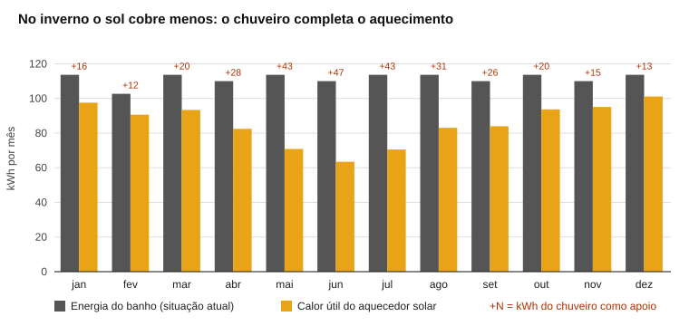

# Resultados calculados

Arquivo gerado por `src/gerar_analise.py` a partir de `dados/parametros.json`. Não edite à mão: altere os parâmetros e rode o script de novo.

Família de referência: 4 pessoas, chuveiro de 5500 W, 10 min por banho, 1 banho por pessoa por dia, 365 dias, tarifa B1 Enel SP sem tributos (R$ 0,78938/kWh).

## Comparação anual

| Situação | Consumo elétrico (kWh/ano) | Custo (R$/ano) | Economia (R$/ano) | Investimento (R$) | Retorno simples | Fração solar | CO2 (kg/ano) | CO2 evitado (kg/ano) | Economia líquida em 15 anos (R$) |
| --- | --- | --- | --- | --- | --- | --- | --- | --- | --- |
| Situação atual (chuveiro elétrico) | 1.338 | 1.056,45 | 0,00 | 0,00 | - | - | 61,7 | 0,0 | 0,00 |
| A - Banho mais curto (sem investimento) | 937 | 739,52 | 316,94 | 0,00 | - | - | 43,2 | 18,5 | 4.754,04 |
| B - Aquecedor solar + chuveiro como apoio | 313 | 246,73 | 809,72 | 3.359,57 | 4,1 anos | 77% | 14,4 | 47,3 | 8.786,26 |
| A+B - Banho mais curto + aquecedor solar | 118 | 92,92 | 963,53 | 3.359,57 | 3,5 anos | 87% | 5,4 | 56,3 | 11.093,41 |

Água economizada na alternativa A: 13.140 litros por ano (vazão de 3,0 L/min).

Conferência física: um chuveiro de 5500 W com vazão de 3,0 L/min aquece a água em 26,3 °C (ΔT = P / (ṁ · c)), compatível com um banho morno.

## Mês a mês (situação atual e alternativa B)

Fração solar de cada mês calculada pelo método f-chart.

| Mês | Irradiação (kWh/m²/dia) | Temperatura do ar (°C) | Energia do banho (kWh) | Fração solar | Calor do sol (kWh) | Apoio do chuveiro em B (kWh) |
| --- | --- | --- | --- | --- | --- | --- |
| jan | 5,23 | 22,3 | 113,7 | 86% | 97,6 | 16,1 |
| fev | 5,44 | 22,4 | 102,7 | 88% | 90,6 | 12,0 |
| mar | 4,91 | 21,6 | 113,7 | 82% | 93,4 | 20,3 |
| abr | 4,36 | 20,0 | 110,0 | 75% | 82,5 | 27,5 |
| mai | 3,52 | 17,1 | 113,7 | 62% | 70,8 | 42,8 |
| jun | 3,26 | 16,3 | 110,0 | 58% | 63,4 | 46,6 |
| jul | 3,48 | 15,9 | 113,7 | 62% | 70,5 | 43,1 |
| ago | 4,15 | 17,2 | 113,7 | 73% | 83,0 | 30,7 |
| set | 4,42 | 19,1 | 110,0 | 76% | 84,0 | 26,0 |
| out | 4,91 | 20,7 | 113,7 | 82% | 93,7 | 20,0 |
| nov | 5,23 | 20,9 | 110,0 | 86% | 95,1 | 14,9 |
| dez | 5,49 | 22,1 | 113,7 | 89% | 101,1 | 12,5 |

Conferência: o sistema entrega em média 42,7 kWh por m² por mês. Um coletor comercial classe A declara 84,3 kWh por m² por mês nas condições de ensaio do Inmetro. O valor calculado aqui é menor porque usa o clima de São Paulo mês a mês e só conta o calor que a família de fato usa no banho; a ordem de grandeza é compatível.

## Sensibilidade da alternativa B

| Coletor | FR(τα)n | FR·UL (W/m²·K) | Custo instalado (R$) | Fração solar | Economia (R$/ano) | Retorno simples |
| --- | --- | --- | --- | --- | --- | --- |
| Pior | 0,65 | 6,5 | 3.359,57 | 67% | 710,46 | 4,7 anos |
| Pior | 0,65 | 6,5 | 6.000,00 | 67% | 710,46 | 8,4 anos |
| Referência | 0,70 | 5,5 | 3.359,57 | 77% | 809,72 | 4,1 anos |
| Referência | 0,70 | 5,5 | 6.000,00 | 77% | 809,72 | 7,4 anos |
| Melhor | 0,75 | 4,5 | 3.359,57 | 86% | 903,82 | 3,7 anos |
| Melhor | 0,75 | 4,5 | 6.000,00 | 86% | 903,82 | 6,6 anos |
